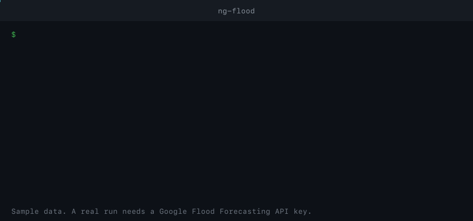
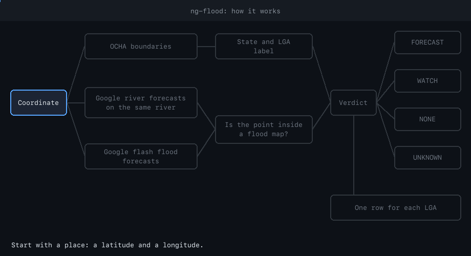

# ng-flood

**See which places a flood will reach, before it gets there.**

Google forecasts river floods in Nigeria days ahead. But those forecasts are
drawn around river stations and map shapes, not around homes, wards and LGAs.
ng-flood joins the two. Give it a place, or a list of thousands, and it tells
you if a flood is forecast there, how soon, and how sure it can be.

A research project by the
[Geohazards Risk Mapping Initiative](https://www.georiskmap.org/about) (GRMI).



## The answer

Every place gets one of four answers.

| Answer | What it means |
| --- | --- |
| `FORECAST` | A flood map covers this place. |
| `WATCH` | A river station nearby is rising, but there is no map to check this exact place. |
| `NONE` | The stations on this river are calm, and no flood map covers this place. |
| `UNKNOWN` | There is not enough fresh, trusted data to say. |

When ng-flood is not sure, it says `UNKNOWN`. It never guesses `NONE`.

`NONE` does not mean safe. It means Google forecasts no river or flash flood
here right now. Rain flooding in towns, the sea, and dam failures are not part
of the forecast.

## Try it

You need [uv](https://docs.astral.sh/uv/) and a Google key (see [Keys](#keys)).

```sh
export GOOGLE_FLOOD_API_KEY=...
uvx ng-flood 7.8023 6.7333
```

```
Verdict:  FORECAST
Point:    lat 7.8023, lng 6.7333
LGA:      Lokoja, Kogi
Area:     postcode not resolved
Riverine: inside HIGH area of gauge ..., SEVERE, trend RISE
Lead:     48 h until the forecast window opens
...
```

Coordinates go latitude first. Check the LGA line: if it names the wrong
place, the numbers are probably swapped. Add `--json` for machine output.

Until the first release is on PyPI, run it from GitHub instead:

```sh
uvx --from git+https://github.com/Adeniyikayodee/ng-flood ng-flood 7.8023 6.7333
```

## Check many places

Put them in a CSV with `id`, `lat` and `lng` columns. The forecasts download
once, and each row becomes one line of JSON.

```sh
uvx ng-flood --sites households.csv >> results.jsonl
```

```json
{"id": "hh-0142", "state": "Kogi", "lga": "Lokoja", "verdict": "FORECAST", "lead_hours": 48.0, "...": "..."}
```

### Roll up by area

To plan by LGA, add `--by lga`. You get one line per LGA, worst first.

```sh
uvx ng-flood --sites households.csv --by lga
```

```json
{"area": "NG023012", "state": "Kogi", "lga": "Lokoja", "sites": 12, "verdict": "FORECAST",
 "FORECAST": 3, "WATCH": 0, "UNKNOWN": 1, "NONE": 8, "errors": 0, "lead_hours": 36.0}
```

An area gets the worst answer among its places. `UNKNOWN` counts as worse than
`NONE`, so one blind spot stops an area looking clear. Every place is counted
somewhere, so the rows always add up to your CSV.

| Flag | Rolls up by |
| --- | --- |
| `--by lga` | LGA, keyed by OCHA's P-code |
| `--by state` | State |
| `--areas wards.geojson --by wardname` | Any shapes you bring, such as GRID3 wards |
| `--by postcode` | NIPOST postcode area (sends each place to NIPOST) |

Add `--records FILE` to keep the line for each place as well.

### Data from KoBoToolbox or ODK

Name the columns your export uses. Give a GPS accuracy column, and any place
with a fix worse than 100 m gets a note.

```sh
uvx ng-flood --sites export.csv --id-col _uuid \
  --lat-col _gps_latitude --lng-col _gps_longitude --accuracy-col _gps_precision
```

`--keep ward,village` copies other columns into each line. Each `id` must be
unique. A row that cannot be read gets an `error`, and the rest carry on.

## Work offline

Download the forecasts once, then check places with no internet and no key.

```sh
uvx ng-flood --fetch today.json.gz
uvx ng-flood --sites households.csv --snapshot today.json.gz
```

Freshness is judged at the time you run it, so an old download gives
`UNKNOWN`, never a false all-clear.

## Check a past answer

Every line records the station, the forecast, when Google issued it, when it
was checked, and the rules that judged it. An answer from a download also
carries `snapshot`, a fingerprint of that file. To replay it exactly:

```sh
uvx ng-flood 7.8023 6.7333 --snapshot today.json.gz --at 2026-10-04T12:00:00+00:00
```

`--evidence kml/` also saves every flood map that covered a place.

Google only serves today's forecast. So this repository saves one download a
day on its `archive` branch, to check answers against the floods that follow.

## How an answer is made



Google measures rivers at **gauges**: real stations, and model points along
the river. When a gauge forecasts a flood, it can publish a **flood map**, a
shape showing where the water may reach.

A gauge only speaks for a place on its own river. ng-flood uses **river
basins**, the patch of land that drains into each stretch of river. A gauge
counts for a place when it sits:

- in the same basin,
- in any basin upstream, or
- in the next basin downstream,

and within 150 km. A calm gauge over a hill, on another river, counts for
nothing. Gauges in Benin, Niger and Cameroon count too, because their rivers
flow into Nigeria.

Then:

- Inside a flood map: `FORECAST`.
- Inside the wider area where Google sends phone alerts, but not a map:
  `WATCH`.
- A rising gauge on the river with no map: `WATCH`.
- A fresh, calm, verified gauge on the river, and every map read: `NONE`.
- Anything else: `UNKNOWN`.

A forecast older than 48 hours is stale. Google marks some gauges as not yet
checked against real measurements. Those can raise an alarm, but never give
`NONE`. The 150 km, 48 hour and basin rules are a first guess, to be tested
against real floods.

## From code or an AI assistant

From Python:

```python
from ng_flood import Client, Failure

with Client(google_key) as client:
    result = client.assess(7.8023, 6.7333)
if not isinstance(result, Failure):
    print(result.verdict, result.lga, result.gaps)
```

As an MCP server, with one tool, `check_flood_forecast`:

```json
{
  "mcpServers": {
    "ng-flood": {
      "command": "uvx",
      "args": ["--from", "ng-flood[mcp]", "ng-flood-mcp"],
      "env": { "GOOGLE_FLOOD_API_KEY": "..." }
    }
  }
}
```

## Privacy

Forecasts are downloaded whole and checked on your machine. Your places never
leave it, unless you ask for postcodes with `--postcode` or `--by postcode`, or
give a NIPOST key to the library or MCP server. Keep names out of the `id`
column.

## Limits

- It checks coordinates, not typed addresses or postcodes.
- LGA lines are simplified to about 500 m, so a place on a border may land in
  the next LGA. Flash flood cells are about 20 km wide.
- A coordinate must be inside Nigeria's border, drawn about 10 km outside the
  real line so places on the edge still count.
- A busy or failed request is tried three times. After three failures in a row,
  ng-flood stops asking that service for the rest of the run.
- If Google cannot be reached, every place still gets a line with the error and
  the time. The exit code is 1 when no place could be checked.
- The decoders follow Google's published format but have not met a live
  response yet. The API is behind a
  [waitlist](https://developers.google.com/flood-forecasting).

## Keys

- **Google:** join the waitlist, enable the Flood Forecasting API on your Cloud
  project, and create an API key.
- **NIPOST**, only for postcodes: a free level 1 key from the
  [developer dashboard](https://dashboard.postcode.gov.ng). Set it as
  `NG_POSTCODE_API_KEY`.

## Develop

```sh
uv run --group dev ruff check . && uv run --group dev mypy && uv run --group dev pytest
```

`scripts/basins.py` and `scripts/areas.py` rebuild the bundled basins and LGAs.

## Research

ng-flood is part of GRMI's research. GRMI makes and shares flood risk maps for
communities in Nigeria. This project asks one question: can a global flood
forecast become a warning a local responder can act on, place by place?

It is research software. Its rules have not yet been tested against real
floods. [docs/validation.md](docs/validation.md) says how they will be.
Findings, issues and field data are welcome.

## Credits

- Flood forecasts: Google Flood Forecasting, CC BY 4.0.
- River basins: HydroBASINS v1c, HydroSHEDS License. Lehner and Grill (2013),
  Hydrological Processes 27(15).
- States and LGAs: OCHA COD-AB Nigeria, CC BY-IGO.
- Postcodes: NIPOST.

ng-flood is not linked to any of them, and it is not an official warning.
Follow NEMA and NIHSA.

MIT licensed.
