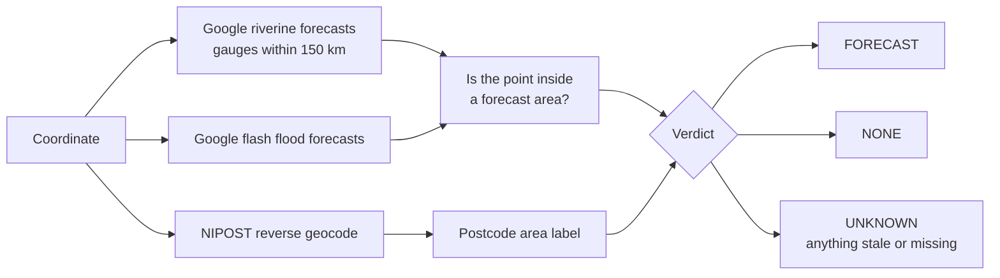

# ng-flood

Google's flood forecast for a Nigerian coordinate, labelled with its NIPOST
postcode area.


The recording shows the real program on sample data.

## How it works



## Use it

Nothing to install: [uv](https://docs.astral.sh/uv/) fetches and runs it.

```sh
export GOOGLE_FLOOD_API_KEY=...   # required
export NG_POSTCODE_API_KEY=...    # optional, adds the postcode area
uvx ng-flood 7.8023 6.7333        # add --json for machine output
```

From an AI assistant, as an MCP server with one tool, `check_flood_forecast`:

```json
{
  "mcpServers": {
    "ng-flood": {
      "command": "uvx",
      "args": ["--from", "ng-flood[mcp]", "ng-flood-mcp"],
      "env": { "GOOGLE_FLOOD_API_KEY": "...", "NG_POSTCODE_API_KEY": "..." }
    }
  }
}
```

From Python, after `pip install ng-flood`:

```python
from ng_flood import Client, Failure

with Client(google_key, nipost_key) as client:
    result = client.assess(7.8023, 6.7333)
if not isinstance(result, Failure):
    print(result.verdict, result.area, result.gaps)
```

## What the verdict means

| Verdict | Meaning |
| --- | --- |
| `FORECAST` | The point is inside a riverine or flash flood forecast area. |
| `NONE` | Fresh gauges are in range, every area was read, and none holds the point. |
| `UNKNOWN` | No gauge within 150 km, or something was stale, missing or unreadable. |

`NONE` is not a promise of safety. It says Google forecasts nothing here now.

## Limits

- Input is a coordinate. NIPOST does not return a coordinate for a postcode
  below its restricted lookup level, so a typed postcode cannot be checked.
- The postcode is a label, not a verification. Riverine maps are about 16 m
  cells with an F1 near 0.7, and flash flood cells are about 20 km, so the
  result is reported by area, not by building.
- Nothing from NIPOST or Google is cached or stored.
- The decoders follow Google's published schema. They have not yet been run
  against live responses: the API is behind a
  [waitlist](https://developers.google.com/flood-forecasting).

## Keys

- Google: join the waitlist, then enable the Flood Forecasting API on your
  Cloud project and create an API key.
- NIPOST: a free level 1 key from the
  [developer dashboard](https://dashboard.postcode.gov.ng).

## Develop

```sh
uv run --group dev ruff check . && uv run --group dev mypy && uv run --group dev pytest
```

## Attribution

Flood forecasts are from Google Flood Forecasting, licensed CC BY 4.0. Postcodes
are from NIPOST. This project is not affiliated with either, and is not an
official warning: follow NEMA and NIHSA.

MIT licensed.
