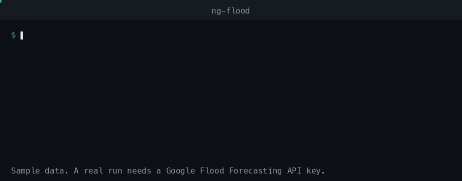
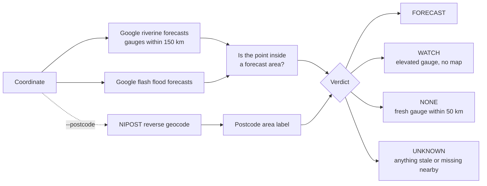

# ng-flood

Google's flood forecast for a Nigerian coordinate, labelled with its NIPOST
postcode area.



The recording shows the real program on sample data.

## How it works



## Use it

Nothing to install: [uv](https://docs.astral.sh/uv/) fetches and runs it.

```sh
export GOOGLE_FLOOD_API_KEY=...   # required
export NG_POSTCODE_API_KEY=...    # only for --postcode
uvx ng-flood 7.8023 6.7333        # add --json for machine output
```

Until the first release is on PyPI, run it from the repository:

```sh
uvx --from git+https://github.com/Adeniyikayodee/ng-flood ng-flood 7.8023 6.7333
```

The same `git+` address works with `pip install` and in the MCP config below.

For many sites, give a CSV with `id`, `lat` and `lng` columns. The forecasts
are downloaded once and each row becomes one JSON record, ready to append to a
log:

```sh
uvx ng-flood --sites households.csv --keep lga,ward --evidence kml/ >> triggers.jsonl
```

```json
{"id": "hh-0142", "lga": "Lokoja", "ward": "A", "verdict": "FORECAST", "lead_hours": 48.0,
 "checked": "2026-10-04T12:00:00+00:00", "nearest_gauge_km": 15.6,
 "riverine": {"gauge_id": "...", "level": "HIGH", "severity": "SEVERE", "polygon_id": "...",
              "issued": "...", "starts": "...", "ends": "...", "change_m": [0.4, 0.9]},
 "areas": {"<polygon id>": "<sha256 of its KML>"},
 "version": "0.1.0", "cover_km": 50.0, "stale_hours": 48.0, "...": "..."}
```

Each record names the gauge, every forecast area that holds the site with the
hash of its KML, when Google issued the forecast, when it was checked, and the
version and thresholds that judged it, so a decision made on it can be audited
later. `--evidence` saves that KML, named by its hash. `lead_hours` is the time
until the riverine forecast window opens.

`--keep` copies CSV columns into each record, so a count by LGA is one line:

```sh
jq -r '[.lga, .verdict] | @tsv' triggers.jsonl | sort | uniq -c
```

For a plan by postcode area, add `--by postcode`. Each line is then one NIPOST
area, worst first, and `--records` keeps the site records behind it:

```sh
uvx ng-flood --sites households.csv --by postcode --records triggers.jsonl
```

```json
{"area": "KG-05-A12-FK", "sites": 12, "verdict": "FORECAST", "FORECAST": 3, "WATCH": 0,
 "UNKNOWN": 1, "NONE": 8, "errors": 0, "lead_hours": 36.0, "checked": "...", "...": "..."}
```

An area takes the worst verdict among its sites, and `UNKNOWN` outranks `NONE`,
so one blind site stops an area reading as clear. `lead_hours` is the shortest
among them. Sites with no postcode share a row whose `area` is `null`, and
failed sites are counted in `errors`, so the rows always add up to the CSV.

A row that cannot be read gets an `error` and does not stop the rest. If Google
cannot be reached, every site still gets an `error` record with the time, so a
failed run leaves a trace. The exit code is 1 when no site could be assessed.

From an AI assistant, as an MCP server with one tool, `check_flood_forecast`:

```json
{
  "mcpServers": {
    "ng-flood": {
      "command": "uvx",
      "args": ["--from", "ng-flood[mcp]", "ng-flood-mcp"],
      "env": { "GOOGLE_FLOOD_API_KEY": "...", "NG_POSTCODE_API_KEY": "..." }
    }
  }
}
```

From Python, after `pip install ng-flood`:

```python
from ng_flood import Client, Failure

with Client(google_key, nipost_key) as client:
    result = client.assess(7.8023, 6.7333)
if not isinstance(result, Failure):
    print(result.verdict, result.area, result.gaps)
```

## What the verdict means

| Verdict | Meaning |
| --- | --- |
| `FORECAST` | The point is inside a riverine or flash flood forecast area. |
| `WATCH` | A gauge within 50 km is above normal or worse and publishes no map to test the point against. |
| `NONE` | A fresh gauge is within 50 km, every area that could reach the point was read, and none holds it. |
| `UNKNOWN` | No fresh gauge within 50 km, or something nearby was stale, missing or unreadable. |

`NONE` is not a promise of safety. It says Google forecasts nothing here now.
Areas are searched from every gauge within 150 km. Each record carries
`nearest_gauge_km`; a stale or missing forecast further than 50 km away is
listed under `notes` and does not change the verdict. The 50 km and 48 hour
thresholds are provisional until they are checked against live data.

## Limits

- Input is a coordinate. NIPOST does not return a coordinate for a postcode
  below its restricted lookup level, so a typed postcode cannot be checked.
- The postcode is a label, not a verification. Flash flood cells are about
  20 km, so the result is reported by area, not by building.
- A coordinate must fall inside Nigeria's border, drawn about 10 km generous.
- Nothing from NIPOST or Google is cached or stored, unless you pass
  `--evidence`.
- No site location leaves your machine by default: Google's forecasts are
  downloaded whole and compared locally. Only `--postcode`, `--by postcode`, or
  a NIPOST key given to the library or the MCP server, sends each coordinate to
  NIPOST.
  Keep names out of the `id` column.
- A 429, a 5xx or a network error is retried twice before it counts as a gap.
  After three failures in a row, forecast areas or postcodes are not asked for
  again in that run. A missing postcode is explained under `notes`.
- If `--evidence` cannot be saved, the run fails and every site gets an `error`.
- The decoders follow Google's published schema. They have not yet been run
  against live responses: the API is behind a
  [waitlist](https://developers.google.com/flood-forecasting).

## Keys

- Google: join the waitlist, then enable the Flood Forecasting API on your
  Cloud project and create an API key.
- NIPOST, only for `--postcode`: a free level 1 key from the
  [developer dashboard](https://dashboard.postcode.gov.ng).

## Develop

```sh
uv run --group dev ruff check . && uv run --group dev mypy && uv run --group dev pytest
```

## Attribution

Flood forecasts are from Google Flood Forecasting, licensed CC BY 4.0. Postcodes
are from NIPOST. This project is not affiliated with either, and is not an
official warning: follow NEMA and NIHSA.

MIT licensed.
